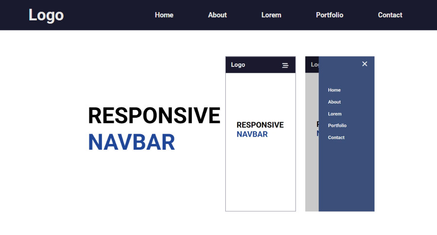

# **Responsive Navigation Bar**

A responsive navigation bar built with **HTML, CSS, and JavaScript**.
This code has the essential functionality of a navigation bar on desktop and mobile devices, without unnecessary animations, complex code, or extra features.

## **Features:**
- Responsive layout for desktop and mobile devices.
- Desktop navigation links.
- Mobile hamburger menu.
- Open and close menu functionality.
- Simple and clean CSS styling.
- Simple JavaScript interactions.

## **Purpose:**
This project was created as a simple learning reference to understand how to build a responsive navigation bar from scratch.
The goal is to keep the code clean, readable, and easy to understand while covering the basic concepts needed to make a navigation bar work on different screen sizes.

## **Getting Started**
- Clone this repository:

*git clone YOUR_REPOSITORY_URL*

- Open the project folder.
- Open index.html in your browser.

## **Preview**

## **License**
*Free to use for learning and educational purposes.*
